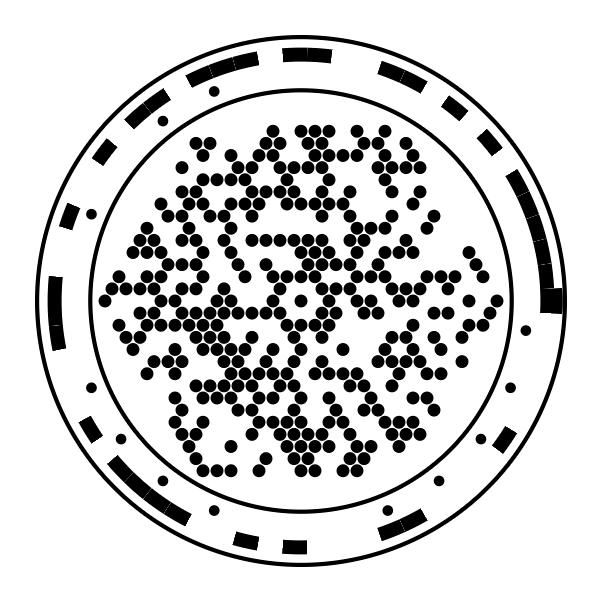
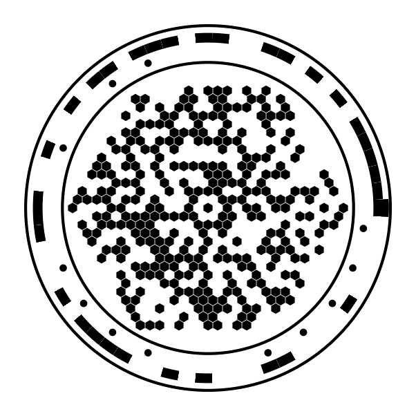
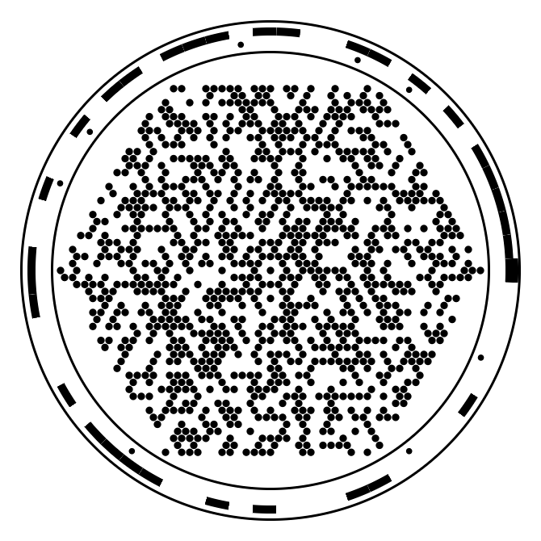
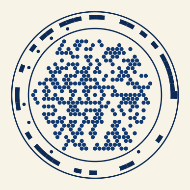
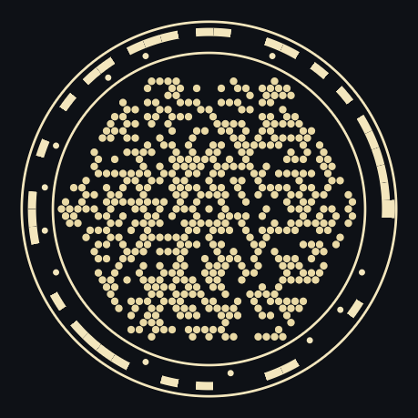
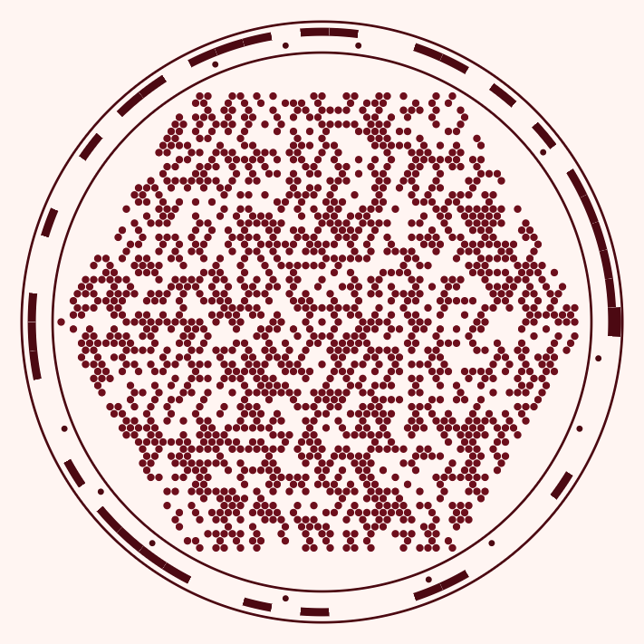

# سیمرغ کد · SiMurgh Code

<p align="center">
  
  &nbsp;&nbsp;
  
</p>

**یک نمادنگاری دوبعدیِ کاملاً تازه — شعاعی، شش‌گوش، با مرزنگاریِ «تاج» — که متن، پیوند و
دادهٔ دودویی دلخواه را حمل می‌کند.**

**A completely new two-dimensional symbology — radial, hexagonal, with a five-band
"Crown" border — that carries arbitrary text, URLs and binary data.**

نه条码 خطی است و نه QR. شبکهٔ داده روی یک **شبکهٔ مثلثی** در حلقه‌های هم‌مرکز نشسته است،
مرزِ نماد از پنج نوار هم‌مرکز ساخته شده (هاله، ۲۴ دانهٔ قالب، ۶۳ دندانِ زاویه‌یاب، منقار،
لیمبوس)، بارِ داده با **رید–سالامونِ درهم‌بسته** محافظت می‌شود، با **DEFLATE** فشرده می‌شود
و با **CRC-32** مهر تأیید می‌خورد. چرخش با یک همبستگی پیدا می‌شود، نه با جست‌وجو؛ و ژستِ
پرسپکتیو از **دو دایرهٔ هم‌مرکز** حل می‌شود، بدون حدس اولیه.

It is not a linear barcode and it is not a QR Code. The data sits on a **triangular
lattice** in concentric rings; the border is built from five concentric bands (Halo,
24 Format beads, 63 Angle-Track teeth, the Beak, the Limbus); the payload is
protected by **interleaved Reed–Solomon**, compressed with **DEFLATE**, and sealed
with **CRC-32**. Rotation is recovered by a single correlation rather than a search,
and perspective pose is solved from **two concentric circles** with no initial guess.

نسخهٔ ۱٫۱ سه چیز اضافه می‌کند: **پاکت رمزنگاری `SECURE`** (ChaCha20-Poly1305 با
اشتقاق کلید PBKDF2 — نماد قفل‌شده بدون کلید فقط یک قفل است، و نماد قفلِ آسیب‌دیده را
نمی‌توان با محاسبه به متن تبدیل کرد)، **هشت پالت رنگی با کف کنتراست WCAG**، **خواندن
نمادهای وارون** (روشن روی تیره)، و دو اپ: یک **PWA نصب‌شدنی** و یک **اپ بومی اندروید**
(کاتلین + CameraX، بدون WebView) که هسته را در یک ماشین‌مجازی QuickJS نهفته اجرا
می‌کند و APK آن در هر پوش با اکشن گیت‌هاب ساخته می‌شود.

Version 1.1 adds a **`SECURE` envelope** (AEAD_CHACHA20_POLY1305 with PBKDF2 key
derivation — a sealed symbol is a lock without the key, and a *damaged* sealed symbol
cannot be computed back into plaintext), **eight palettes with a WCAG contrast
floor**, **inverted-symbol reading** (light ink on dark substrate), an
**installable PWA**, and a **native Android app** — Kotlin, CameraX, no WebView —
that runs the same core inside an embedded QuickJS VM and whose debug APK is built
by GitHub Actions on every push.

Everything in this repository is written from scratch with **zero runtime
dependencies** — including the RFC 1951 DEFLATE codec, the ChaCha20-Poly1305 AEAD
and the PNG reader in the CLI.

---

## چرا این طرح؟ · Why this design

| | سیمرغ کد | چرا مهم است / Why it matters |
|---|---|---|
| **شبکهٔ مثلثی**<br>Triangular lattice | چگالی `π/(2√3) ≈ 0.907` | ≈۱۵٪ سلول بیشتر در همان مساحت جوهر نسبت به شبکهٔ مربعی |
| **مرزنگاری تاج**<br>The Crown | ۵ نوار هم‌مرکز با نسبت شعاع معلوم | یک حلقهٔ ردیابی‌شده، شعاعِ همهٔ نوارها و گامِ محلی را روی هر پرتو می‌دهد |
| **دندهٔ زاویه**<br>Angle Track | دنبالهٔ m مرتبهٔ ۶، `p(x)=x⁶+x+1`، ۶۳ دندان | خودهمبستگی چرخه‌ای `−1` ⇒ چرخش با یک همبستگی، حتی با ۴۰٪ پوشیدگی |
| **تاجِ قالب**<br>Format Crown | کد گولی گستردهٔ `(24,12)`، ۲۴ دانه | فاصلهٔ حداقل ۸: ۳ خطا اصلاح، ۴ خطا آشکارسازی |
| **مسیر مارپیچی**<br>Serpentine path | هر دو ماژول پیاپی، همسایهٔ شبکه‌اند | خرابیِ فشرده ⇒ `O(R)` پاره‌خط ⇒ **۱۶ برابر** سطحِ قابلِ اصلاح |
| **پیش‌پوشش**<br>Mask prior | آزمون فرضیه روی ۱۹ سلول همسایه، `Binomial(19,½)` | لکه/سوراخ به‌جای «خطا» به‌صورت «محو» اعلام می‌شود که دو برابر ارزان‌تر است |
| **فشرده‌سازی**<br>DEFLATE | RFC 1951 درون هسته، بدون وابستگی | متن فارسی: تا **۴٫۹ برابر** دیسک کوچک‌تر؛ متن تکراری: ۸٫۴ برابر |
| **CRC-32**<br>the arbiter | داور نهایی هر رمزگشایی | پذیرش کاذب `2⁻³²`، حتی وقتی رید–سالامون خطا را «اصلاح» کند |
| **پاکت SECURE**<br>mode 10 | AEAD_CHACHA20_POLY1305 + PBKDF2 | بدون کلید: فقط رمزنگاشته؛ بازسازی ریاضیِ نماد آسیب‌دیده، رمزنگاشته را کامل می‌کند نه متن را |
| **وارون‌خوانی**<br>polarity | هیستوگرام + یک تلاش محدود | نماد روشن‌روی‌تیره (چاپ سفید، حالت تاریک نمایشگر) مثل نماد معمولی خوانده می‌شود |
| **پالت‌ها**<br>palettes | کف کنتراست ۷:۱ (چاپ) | رنگ، هندسه را لمس نمی‌کند؛ هر پالت با کاهش لومینانسِ دوربین آزموده می‌شود |

## نمونه‌ها · Samples

<p align="center">
  
</p>

<p align="center">
  
  &nbsp;
  
  &nbsp;
  
</p>

<p align="center"><sub>چپ به راست: پالت لاجورد · نماد وارون (روشن روی تیره) · نماد
مهر و موم‌شده — هر سه با همین مخزن ساخته و دوباره خوانده شده‌اند؛ سومی بدون کلید فقط
«قفل» گزارش می‌شود.<br/>Left to right: the lapis palette · an inverted symbol · a
sealed symbol. All three were rendered and re-read by this repository; the third
reports only "locked" without its passphrase.</sub></p>

هر سه تصویر بالا با همین CLI ساخته شده‌اند و دوباره با همین CLI خوانده شده‌اند —
بدون هیچ ویرایش دستی.

All three images above were produced by the CLI in this repository and read back by
it, with no manual editing.

## شروع سریع · Quick start

```sh
npm install
npm run build          # packages/core + packages/cli  (tsc -b)
npm test               # 161 tests
npm run typecheck      # core, cli, web and mobile
npm run dev            # playground on http://localhost:5173
npm run mobile         # the installable mobile app on http://localhost:5174
npm run icons          # regenerate PWA + Android icons from a live symbol
```

### خط فرمان · Command line

```sh
# a Persian URL as SVG artwork (0.6 mm per module), with a caption
npm run cli -- encode "https://simurgh.example/fa/سلام-世界" -o symbol.svg

# a PNG at 14 px per module, level H, then read it back
npm run cli -- encode "https://example.com/p/12345" -o symbol.png -s 14 -e H
npm run cli -- decode symbol.png --json

# raw binary from a file, and a self-check that the artwork is scannable
npm run cli -- encode --file firmware.bin --binary -o part.png -s 16 --selftest

# the whole capacity table, one level, one version
npm run cli -- capacity
npm run cli -- capacity --ecc H --version 10

# seal a payload; without the passphrase the symbol reports LOCKED only
npm run cli -- encode "رمز گاوصندوق ۴۷۲" --pass 'correct horse' -o vault.png --selftest
npm run cli -- decode vault.png                      # -> LOCKED: 42 B sealed with PBKDF2...
npm run cli -- decode vault.png --pass 'correct horse'
npm run cli -- decode vault.png --keys ring.txt      # "<hex key id>=<passphrase>" per line

# a themed, print-safe palette (contrast is reported in the SVG metadata)
npm run cli -- encode "https://simurgh.code" --theme turquoise -o art.svg
npm run cli -- encode "https://simurgh.code" --theme lapis -o art.png -s 12

# the frozen specification constants, including the Angle Track bit string
npm run cli -- spec

# timing for all four ECC levels plus a compression comparison
npm run cli -- bench
```

`encode` writes `svg`, `png`, `pgm`, `ascii` or `json` — chosen by the output
extension or `--format`. With no `-o` it prints ASCII art to the terminal.

### کتابخانه · Library

```ts
import { encode, decode, payloadToText, toModel, unpackFormat } from '@simurgh/core';
import { renderSVG, renderRaster } from '@simurgh/core/render';
import { decodeImage } from '@simurgh/core/imaging';

const symbol = encode({ url: 'https://example.com/fa/سلام', ecc: 'M' });
symbol.version;            // 1        (smallest disc that fits)
symbol.plan.payloadBytes;  // 51       (user payload; the CRC-32 is extra)
symbol.inkCoverage;        // 0.502

const svg = renderSVG(toModel(symbol));            // artwork, mm or px
const img = renderRaster(toModel(symbol), { scale: 10 });   // greyscale raster

const sealed = encode({ text: 'vault pin 4712', secure: { key: 'correct horse' } });
sealed.secure.keyId;   // Uint8Array(4) -- printed, so a keyring can route

const locked = decodeImage(renderRaster(toModel(sealed), { scale: 8 }));
locked.ok;             // true  -- the *symbol* still decodes
locked.encrypted;      // true  -- but the payload is a lock
locked.secureInfo;     // { suite, keyId, iterations, salt, plaintextBytes }

const opened = decodeImage(img, { secure: { key: 'correct horse' } });
payloadToText(opened.payload!);                    // 'vault pin 4712'

const result = decodeImage(img);                   // the full imaging pipeline
result.ok;                                         // true
payloadToText(result.payload!);                    // 'https://example.com/fa/سلام'
result.diagnostics.teethMatches;                   // 63
result.diagnostics.meanConfidence;                 // 0.97
```

At the bit level, without any imaging:

```ts
const res = decode({ dataBits: symbol.dataBits, format: unpackFormat(symbol.formatBits) });
```

### زمین‌بازی وب · Web playground

`npm run dev` serves a Persian, right-to-left playground that runs entirely in the
browser:

1. **رمزگذاری** — live encoding with ECC, version, mask, module shape, quiet zone and
   compression controls; SVG preview, full statistics, the machine-readable format
   record, and SVG/PNG download.
2. **آزمایشگاه مقاومت** — degrade the rendered symbol with rotation, perspective,
   Gaussian noise, blur, print fade, occlusion and resolution reduction, then decode
   it and read the diagnostics: located version, recovered pitch and rotation,
   homography rms, teeth matched, erasure cells, mask-prior seeds, CRC. Eight
   one-click presets, including one that is deliberately past the code's reach.
3. **رمزگشایی از پرونده** — upload any PNG or JPEG of a printed or photographed
   symbol; nothing leaves the browser. Sealed symbols ask for their passphrase
   inside the page and open there.
6. **قفل و پالت** — the seal switch (passphrase, PBKDF2 cost, hidden context) and
   the eight-palette picker sit in the encoder card; the lab decodes what a camera
   would see, colours included.
4. **جدول ظرفیت** — all 40 versions × 4 ECC levels.
5. **مرزنگاری و ریاضیات** — the Crown's five bands and the decoding chain, explained.

## اپ موبایل · The mobile app

`apps/mobile` is a Persian, right-to-left, **installable PWA**: two tabs
(ساخت / اسکن), a live camera viewfinder whose reticle is the Format Crown itself,
unlocking of sealed symbols, offline operation through a service worker, and a
download path for PNG/SVG. Decoding runs in a Web Worker so the viewfinder never
stutters; key derivation uses the platform's native PBKDF2.

`apps/android` is a **native** Kotlin app (`code.simurgh.scanner`): Material XML
views, a CameraX viewfinder with per-frame analysis, MediaStore saving and
FileProvider sharing — no WebView, no HTML, and no INTERNET permission, so it is
offline by construction. The symbology itself is the same TypeScript core bundled to
`assets/engine.js` and executed in an embedded QuickJS VM over a single JNI bridge
(`SimurghEngine.call(json) -> json`), which keeps the phone bit-identical to the
reference instead of a second, drifting port. JVM unit tests run that shipped bundle
in a real QuickJS runtime against differential vectors generated from the TS core,
and `.github/workflows/android.yml` builds one **universal APK** on every push —
verified to carry the QuickJS native library for all four phone CPU architectures
(`armeabi-v7a`, `arm64-v8a`, `x86`, `x86_64`), installable from **Android 6.0
(API 23)** to the newest release, and published to **GitHub Releases**
(`v<version>-android` plus a rolling `latest`) on every build of `main`. The
launcher icons are themselves scannable v3 symbols.

## اعداد کلیدی · Key numbers

| | |
|---|---|
| نسخه‌ها / Versions | 1 … 40 |
| سلول‌های داده / Data cells | 612 (V1) … 25 650 (V40) |
| قطر چاپ / Printed diameter | 38 … 194 modules (+2.5 quiet zone) |
| گنجایش مفید / Usable payload | 30 … 2 689 bytes (H … L, uncompressed) |
| سطوح تصحیح خطا / ECC | L 16 %, M 28 %, Q 40 %, H 55 % parity |
| دنده‌های زاویه / Teeth | 63 (order-6 m-sequence, 5.714286° each) |
| دانه‌های قالب / Beads | 24 (extended Golay, minimum distance 8) |
| پوشش‌ها / Masks | 8, chosen by a three-term penalty |
| کف وضوح / Resolution floor | 4 px/module native, 2.33 px/module resampled |
| تحمل آسیب / Damage tolerance | 12 % hole at M, 14 % at Q, 18 % at H |
| آزمون‌ها / Tests | 116 passing (`math`, `pipeline`, `imaging`) |
| وابستگی‌های زمان اجرا / Runtime deps | **none** |

## مستندات · Documentation

| سند | محتوا |
|---|---|
| [`docs/01-SPECIFICATION.md`](docs/01-SPECIFICATION.md) | مشخصات هنجاری: هندسه، تاج، دندهٔ زاویه، قالب، جایگذاری داده، تصحیح خطا، حالت‌های بار، پوشش‌ها، الگوریتم رمزگشایی، ابعاد چاپ، انطباق |
| [`docs/02-MATHEMATICS.md`](docs/02-MATHEMATICS.md) | ریاضیات کامل با اثبات و اندازه‌گیری: شبکهٔ مثلثی، دنباله‌های m، کد گولی و شعاع پوشش، رید–سالامون و درهم‌بستگی، مسیر مارپیچی و قضیهٔ همسایگی، آزمون فرضیهٔ پیش‌پوشش، هندسهٔ تصویریِ حلِ ژست، فشرده‌سازی، چگالی اطلاعات، نظریهٔ نمونه‌برداری |
| [`docs/03-CAPACITY.md`](docs/03-CAPACITY.md) | جدول کامل ظرفیت ۴۰×۴، هزینهٔ واقعی بارهای رایج، قاعدهٔ انتخاب نسخه، مقایسهٔ صادقانهٔ چگالی، اندازه‌های چاپ، سقف ظرفیت |
| [`docs/04-ROADMAP.md`](docs/04-ROADMAP.md) | وضعیت، مرزهای شناخته‌شده، و برنامه در سه افق کوتاه/میان/بلندمدت |
| [`docs/05-SECURITY.md`](docs/05-SECURITY.md) | مدل امنیتی: دو لایهٔ قالب و مهر، فهرست صادقانهٔ نشت اطلاعات، چه چیزی آزموده شده و چه چیزی نیست، مدیریت کلید |

## ساختار مخزن · Repository layout

```
packages/core/src/
  geometry.ts      lattice, rings, serpentine path, Crown constants, Angle Track, masks
  blocks.ts        block planning, interleaving, capacity table
  segments.ts      payload modes, cost model, automatic segmentation
  format.ts        Golay(24,12) Format Crown
  encoder.ts       encode(), multi-frame streams, CapacityError
  decoder.ts       bit-level decode, per-block erasure budgets, format ladder
  gf256.ts         GF(2^8) arithmetic and matrix inversion
  reed-solomon.ts  Berlekamp-Massey / Chien / Forney, erasures, residual check
  golay.ts         exhaustive maximum-likelihood G24 decoder
  crc.ts           CRC-32, CRC-16, FNV-1a, xorshift RNG
  deflate.ts       RFC 1951 deflate + inflate, no dependencies
  chacha20.ts      ChaCha20, Poly1305, the RFC 8439 AEAD, PBKDF2-HMAC-SHA256
  sha256.ts        SHA-256, MAC tag, constant-time comparison
  model.ts         SymbolModel: the printable description of one symbol
  render/          raster (signed distance fields), SVG, ASCII, palettes
  imaging/         locate, orient, sample, damage, decode, simulate, polarity

packages/cli/src/  simurgh CLI + a dependency-free PNG reader/writer
apps/web/          the playground (Vite, no framework)
apps/mobile/       installable PWA: create, camera scan, unlock (Vite + worker)
apps/android/      native Kotlin app: QuickJS engine host, CameraX scan, CI-built APK
tools/             engine bundle, Android vectors/bundle checks, m-sequence derivation
docs/              specification, mathematics, capacity, security model, roadmap
```

## آزمون‌ها · Tests

```sh
npm test                       # all 161
npm run test:watch             # watch mode
npx vitest run packages/core/test/imaging.test.ts   # one suite
```

The suites are written to fail loudly on the mistakes that are easy to make
silently: the DEFLATE encoder is tested **against `node:zlib` in both directions**,
not only against itself; the mode-cost model is tested against what the writer
actually emits; and the imaging tests assert the payload text, not just `ok`.

In CI, eight more JVM tests (`apps/android`) execute the *shipped* engine bundle in
a real QuickJS runtime and compare it bit for bit against vectors from the
reference core: encode exactness, sealed envelopes, full image decode, and the
Persian/quote/newline JNI bridge.

## وضعیت · Status

Specification **1.1.0**, 2026-10-29. The encoder, the bit-level decoder, the full
imaging reader, the SECURE envelope and the palette/polarity layers are complete and
tested; the CLI, the playground, the PWA and the native Android app work end to
end, and CI builds the debug APK. Known limits — including what damage is genuinely
beyond the code, and that no on-device run has been observed yet — are listed
honestly in
[`docs/04-ROADMAP.md`](docs/04-ROADMAP.md#2-known-limits-stated-plainly) and
[`docs/05-SECURITY.md`](docs/05-SECURITY.md).

## پروانه · License

MIT. The specification is published with the intent that anyone may implement it;
see the roadmap for the standardisation position.

---

<p align="center"><b>سیمرغ</b> — سی مرغ نبودند؛ سیمرغ خودِ آنان بود.<br>
<i>Attar's thirty birds discovered that the Simurgh they sought was themselves.</i></p>
