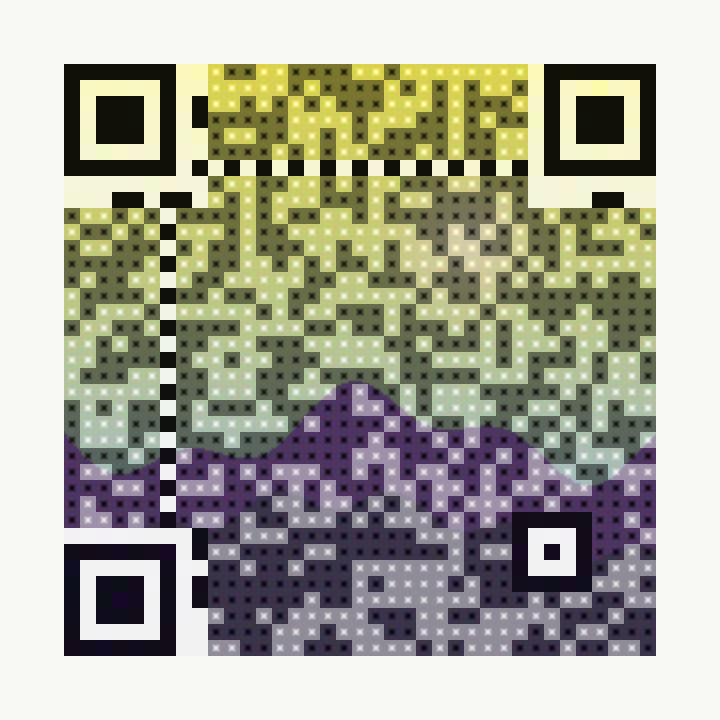

# QRArt — نقاشی و عکس داخل کیوآر کد، با تضمین اسکن

**QRArt** یک اپ بومی اندروید است که عکس یا نقاشی شما را **داخل خودِ کیوآر کد** می‌نشاند —
نه به‌صورت یک برچسب روی کد، بلکه طوری که رنگ و تُن اثر هنری در تمام سطح کد جاری باشد —
و سپس با دیکودر مرجع ZXing **اثبات می‌کند** که نتیجه اسکن می‌شود.

این پروژه جایگزین کامل اپ قبلی (ArtQR/qrstudio) است: آن اپ عکس را تقریباً به دو تُن تخت
تقلیل می‌داد (یعنی عکس عملاً دیده نمی‌شد) و هیچ مکانیزم راستی‌آزمایی تدریجی نداشت.

---

## QRArt — paintings fused into QR codes, provably scannable

A native Android app that puts your photo or painting **inside the QR code itself** —
not as a sticker on top, but flowing through every module as colour and tone — and then
*proves* the result scans, with the ZXing reference decoder, on the device and in CI.

## How the art survives binarization (the actual technique)

Scanners never see colour; they compute **luminance**, threshold it *locally*
(ZXing: 8×8 block means), and then **sample each module's centre pixel only**.
Research (Chu et al.; "QR Images"; ART-UP; the ControlNet "QR Code Monster" workflow
that popularised the artistic look) agrees on what is free and what is sacred:

| Region | Freedom | Why |
|---|---|---|
| Module **core** (middle third) | must carry the bit, with margin | it is the sampled pixel; a correct core is sufficient to decode the module |
| Module **body** (edges) | free art, inside a luminance corridor | never sampled; only needs to stay on the correct side of a mid threshold (dark ≤ 0.46, light ≥ 0.54) |
| Finder / separator / timing / format / version / alignment | **none** — pristine, max contrast | not Reed-Solomon protected; finder ratios 1:1:3:1:1 locate the symbol |
| Quiet zone | uniform light, ≥ 4 modules | boundary detection |
| Centre emblem | ≤ ~12% area, inside the format rings, never over function patterns | ECC H pays for the damage |

So each module is painted with the photo's own hue and tone, mapped into two bands:
a wide **body corridor** (the painting stays recognisable) and a tight **core** that is
always an extremum of its own module — which is exactly what an adaptive binarizer
cannot flip. `ArtRenderer.kt` implements this; `Bands.LEVELS` is the safety ladder.

### The guarantee (`Guarantee.kt`)

Every render is decoded back with ZXing before it is shown. If the artistic request was
too bold, the ladder escalates: narrower corridors → smaller emblem → nearly flat →
plain dark-on-light (structurally always readable). The UI reports which level was
needed, so "scannable" is a measurement, never a promise.

## Samples (generated by the same algorithm, verified by ZXing-C++ and ZXing-Java)

| Fusion / تلفیق | Poster / پوستر |
|---|---|
|  |  |

## Styles

- **Fusion / تلفیق** — the painting *is* the code (the artistic look).
- **Poster / پوستر** — full-bleed photo with the code on a light plate inside it.
- **Classic / کلاسیک** — flat palette derived from the photo, optional centre emblem.

## Verification

- `app/src/test/.../FusionScannabilityTest.kt` renders every style against six hostile
  synthetic paintings (near-black, flat pastel, white noise, radial, gradient, blocky)
  and decodes them with ZXing — including a **simulated camera capture** (box
  downsample to 5–8 px/module + Gaussian blur). A pretty-but-unreadable render fails CI.
- Locally, the same renders are checked against **ZXing-C++** (the strict C++ port of
  ZXing) including simulated captures down to 5 px/module: 36/36 fusion and 48/48
  poster+classic combinations decode.
- On-device: each render is test-decoded and the badge shows `✓ Scannable (ZXing, N ms)`.
- Encoding goes through the ZXing reference encoder, so the data layer is spec-exact.

## Build & release

CI (`.github/workflows/qrart.yml`): JVM scannability tests + `assembleDebug` on every
push; on `main` it publishes one universal debug-signed APK to GitHub Releases as
`qrart-v<version>` and rolling `qrart-latest`. Pure Kotlin/Java — no native libraries,
one APK for all ABIs, Android 5.0 (API 21)+. Stack: Gradle 9.7.1, AGP 9.4.0,
Kotlin 2.4.10, JDK 21, compileSdk 36.
